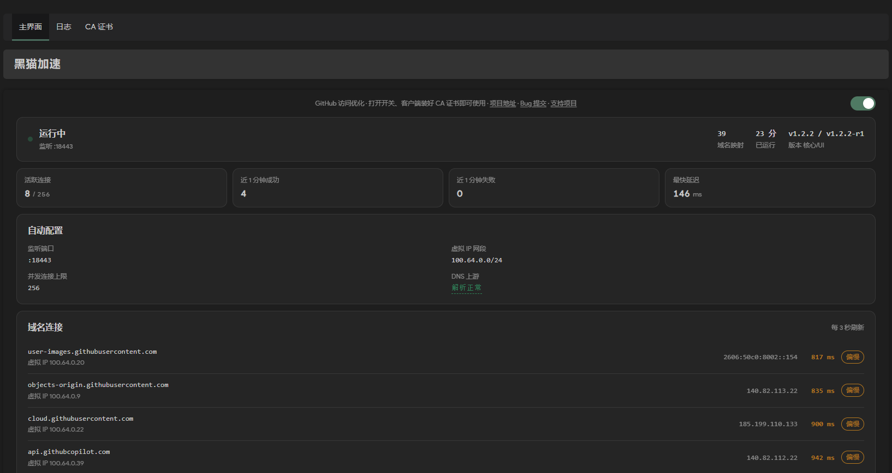

# 黑猫加速（ghboost）

黑猫，即github。

GitHub 访问优化插件。DNS 防污染解析 + 本地透明重定向 + 真实 IP 实测选路，自动选择最快可达节点。

仅对github访问生效，不提供通用代理，不具备「翻墙」功能。

- `ghboost` — 核心包，Go 单文件二进制
- `luci-app-ghboost` — 界面包，LuCI 页面

## 特性

- DoH 防污染解析，多上游并发查询后合并
- 真实 IP 实测选路，失败自动降权并切换
- 按域名控制上游 SNI：`none` / `domain` / `random`

## 客户端安装 CA

首次启动插件后，会生成 CA 证书。客户端需安装该证书，才能正常访问 GitHub。

| 平台 | 命令 / 步骤 |
|---|---|
| Windows | 管理员 PowerShell：`certutil -addstore -f Root C:\ghboost-ca.crt` |
| macOS | `sudo security add-trusted-cert -d -r trustRoot -k /Library/Keychains/System.keychain ~/Downloads/ghboost-ca.crt` |
| Linux | `sudo cp ghboost-ca.crt /usr/local/share/ca-certificates/ && sudo update-ca-certificates` |
| iOS | 设置 → 通用 → VPN与设备管理 → 安装，再到「证书信任设置」开启 |
| Android | 设置 → 安全 → 加密与凭据 → 安装证书 → CA 证书 |

Firefox 用独立证书库，需在「设置 → 隐私与安全 → 证书 → 查看证书 → 证书机构」单独导入。

## 常见问题

**客户端提示证书不受信任** — 证书丢失，插件会重新生成证书，客户端需要重新安装新的证书。

**53 端口被其他插件占用** — 把重定向 53 端口的插件改为 dnsmasq 的上游服务器，否则 fake IP 应答不生效。

## 界面预览

